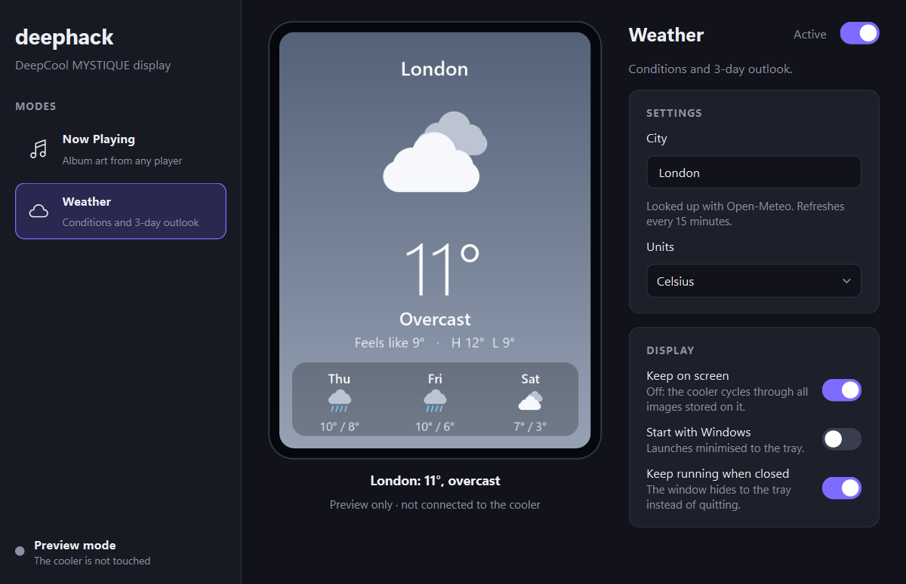

# deephack

Custom content for the LCD on the **DeepCool MYSTIQUE** liquid cooler: the album art of whatever you are
listening to, the weather, and whatever comes next.



The official DeepCool app can show sensor readouts and images you upload by hand. deephack talks to the
cooler directly over USB and keeps one image slot up to date with content it renders itself.

## Modes

| Mode | What it shows |
| --- | --- |
| **Now Playing** | Cover, title and artist of the current track. Uses Windows' system media controls, so it works with Spotify, anything playing in a browser, foobar2000 and so on. |
| **Weather** | Current conditions and a three day outlook for a city you pick, from [Open-Meteo](https://open-meteo.com) (no account or key). |

**Keep on screen** decides whether the cooler stays on deephack's image or cycles through every image
stored on it (the cooler's own slideshow).

## Install and run

Windows 10/11 and Python 3.11+.

```powershell
git clone <this repo> deephack
cd deephack
python -m venv .venv
.\.venv\Scripts\pip install -e .
.\.venv\Scripts\deephack.exe
```

The window closes to the system tray; quit from the tray menu. "Start with Windows" adds a per-user
autostart entry.

### Things to know

- **Quit the DeepCool app first.** It holds the cooler's USB interface exclusively. deephack shows a banner
  with a button for that. The DeepCool app starts with Windows by default, so disable its autostart if you
  want deephack to own the display after a reboot. Fan control is a separate Windows service and keeps working.
- **Every update is a write to the cooler's flash.** There is no known way to draw without storing the
  image first. deephack rate-limits writes (at most one every 8 seconds, tracks have to settle before they
  are drawn), but the flash endurance of the device is unknown. "Cover only" writes once per album instead
  of once per track.
- **deephack adds one image the DeepCool app does not know about.** It is stored after the JPGs you uploaded
  with the official app. If you later add images there, its numbering will be off by one;
  `python -m deephack.device delete <index>` removes deephack's image (the index is `slot_index` in
  `%APPDATA%\deephack\config.json`).
- Only the MYSTIQUE (USB `3633:0009`, 480x640 portrait) is supported. The MYSTIQUE PLUS appears to share
  much of the protocol but is untested.

## Adding a mode

A mode is a class that returns a 480x640 Pillow image whenever the display should change:

```python
# deephack/modes/hello.py
from .. import render
from .base import Mode

class Hello(Mode):
    id, title, description, glyph = "hello", "Hello", "Says hello", ""

    async def frame(self):
        if getattr(self, "_done", False):
            return None            # nothing changed, no flash write
        self._done = True
        return render.message("Hello", "from the cooler")
```

Add it to `MODES` in `deephack/modes/__init__.py`. Declare `settings` on the class and the UI builds the
form for you (see `weather.py`). `python -m deephack --no-device` runs the UI without touching the cooler.

## Protocol

Reverse engineered from the official app (v1.2.15, Electron) by attaching to its debug port and logging
its USB transfers; the tooling is in [`tools/`](tools). Tested against one device (USB `bcdDevice` 2.47).

The cooler is a full-speed vendor-class device with two bulk endpoint pairs (`0x01/0x81` for commands and
uploads, `0x02/0x82` for the periodic sensor feed).

**Command frame**, 48 bytes, answered with the same layout starting with `55`:

```
AA 2E <cmd> <payload, zero padded to 39 bytes> 'H' 'I' 'D' 'C' <sum16 LE of bytes 0..45>
```

| cmd | meaning | payload |
| --- | --- | --- |
| `01` | sensor values (ep 2, once a second) | not decoded |
| `02` | device options | not decoded |
| `03` | display mode | `mode` (2 = stored images) |
| `07` | slideshow | `duration` `animation` (0 none, 1 slide, 2 fade) |
| `08` | show stored image | `type` (0 jpg, 1 gif) `index` |
| `09` | delete stored image | `type` `index` |
| `0A` | set clock (ep 2) | `year:u16` `month` `day` `hour` `minute` `second` |
| `0F` | start upload | none |
| `12` | get UUID | reply: status byte + 32 ASCII characters |

**Image upload**

1. command `0F`, wait for the reply
2. 64 byte header: `"DCLd"`, type (1), size `u32`, sum16 of the data as `u32`, 7 zero bytes, 32 character
   file id, 10 zero bytes, sum16 of the first 62 header bytes as `u16`
3. the JPEG in 64 byte packets: 480x640, baseline, 4:2:0
4. `"dcldfinish"` zero padded to 55 bytes; no reply, the device then writes to flash (wait about a second)
5. command `08` to show it

Uploading with an id that already exists replaces that image in place.

`python -m deephack.device --help` exposes the driver on the command line.

## Disclaimer

Not affiliated with or endorsed by DeepCool. This talks to your hardware in ways the vendor did not
document; use it at your own risk.
